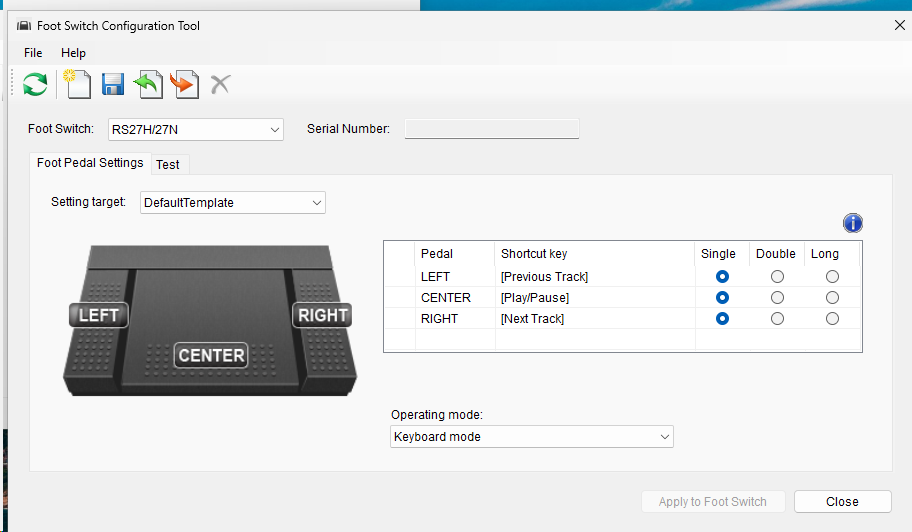

# Olympus RS-27H foot switch — Linux integration

Working notes for the Olympus / OM SYSTEM **RS-27H** USB foot switch (August 2026). Covers what the device is, what it looks like to
the Linux input stack, how it gets configured, and how to source a spare.

Opened 2026-08-13. The per-unit USB serial is replaced with `<serial>` throughout.

## Status

| Item | State |
| --- | --- |
| Device recognised by Linux | **Confirmed** — enumerates as a HID device, no driver needed |
| USB / evdev identity recorded | **Confirmed** — see [docs/hardware.md](docs/hardware.md) |
| Per-pedal event codes captured | **Not done** — capture window ran, no presses were recorded; parked 2026-08-13 |
| Number of physical pedals | **Unresolved** — vendor documents 3 buttons, unit was described as one tread; see below |
| Momentary (hold) vs canned keystroke | **Not verified** — this is the load-bearing question for push-to-talk |
| Vendor config tool run | **Done 2026-11-14** — OM Foot Switch Configuration Tool 2.0.1 in the `win11` VM on danieldesktop; decompiled and reimplemented |
| Configure from Linux | **Working 2026-11-14** — `tools/omfs.py` reads/writes bindings, USB mode, backup/restore; protocol in [docs/config-protocol.md](docs/config-protocol.md) |
| Firmware | `Ver 1.01` (item 2), model `RS-27H` (item 0), read 2026-11-14 |
| Context-dependent mapping built | Not started |

## The goal this device was bought for

Push-to-talk dictation while both hands stay on keyboard and mouse. The target
mapping is context-dependent:

- in **Claude Code** → the pedal acts as `Space`
- **everywhere else** → the pedal acts as `F13`

`F13` is chosen because no physical keyboard emits it, so nothing else in the
desktop can collide with it. See [docs/linux-integration.md](docs/linux-integration.md)
for how that mapping is intended to work and why the vendor's Windows tool is
the wrong layer to put it in.

## Pedal event codes (captured 2026-11-14)

Three independent switches, confirmed by pressing each one with `evtest` on the
default (vendor) firmware mode. The kernel names are mouse-button names and are
**mirrored**: the left pedal is not `BTN_LEFT`.

| Physical pedal | Code | evdev name |
| --- | --- | --- |
| Left | 274 | `BTN_MIDDLE` |
| Centre | 273 | `BTN_RIGHT` |
| Right | 272 | `BTN_LEFT` |

All three are momentary: one press is `value 1` on press and `value 0` on
release, with no auto-repeat (`value 2`) events. A 2.7 s hold on the centre pedal
produced a single press and a single release, so hold-to-talk works without
vendor configuration. Raw capture: `captures/evtest-presses-2026-11-14.txt`.

A second capture (`captures/evtest-holds-chords-2026-11-14.txt`) held left and
right for about 2.5 s each, pressed every two-pedal combination and all three
together, and double-tapped the centre. Result: **no codes beyond 272–274**,
even though the descriptor advertises 32 (256–287). Chords report each pedal
independently, so there is no combined code, and a double-tap is two plain
press/release pairs about 0.2 s apart, with no firmware double-tap detection.
This matches the manufacturer's description of the RS-27H as a 3-pedal switch
(Play/Stop, Rewind, Fast Forward). OM System does not document the vendor-mode
HID report layout; the press types "single / double / long" in its
Configuration Tool apply to Keyboard mode only.

### Below evdev: the raw HID layer (verified 2026-11-14)

To rule out data the kernel receives but drops, the HID report descriptor was
read from sysfs (`captures/hid-report-descriptor-2026-11-14.txt`) and raw reports
were read from `/dev/hidraw*` while every pedal was tapped and held
(`captures/hidraw-reports-2026-11-14.txt`).

The device has one configuration, one HID interface and one endpoint (`0x81`,
IN, 64 bytes, 10 ms polling). The descriptor (Consumer page, application
collection) declares:

| Report | Size | Contents |
| --- | --- | --- |
| Input | 4 bytes | 32 one-bit buttons, Button usages 1–32 → evdev 256–287 |
| Input | 60 bytes | Consumer usage `0x00` (unassigned), signed 8-bit values. **Linux maps no event to this, so evdev cannot see it** |
| Output | 64 bytes | Host-to-device data, Consumer usage `0x00`. Presumably the vendor command channel used by the Configuration Tool and ODMS (inferred, undocumented) |

There are no Feature reports. Observed raw reports, all 64 bytes long:

| Button bytes | Meaning | evdev |
| --- | --- | --- |
| `00000100` | Button 17 = right pedal | 272 |
| `00000200` | Button 18 = centre pedal | 273 |
| `00000400` | Button 19 = left pedal | 274 |
| `00000600` | Left and centre together (bits OR together) | 273 + 274 |
| `00000000` | All released | — |

The 60 unlabelled bytes were **zero in every report**, including during holds.
So evdev is not hiding anything the pedal sends: only bits 17–19 of the 32 are
ever set, and the other 29 button bits correspond to no physical switch.

The **64-byte output report** is the vendor command channel. It was decoded on
2026-11-14 from the Configuration Tool itself; see
[docs/config-protocol.md](docs/config-protocol.md). The one-interface description above is the
legacy `0218` enumeration. As `0292` (since 2026-11-14) the unit exposes **three** HID interfaces
(`/dev/hidraw7`–`9` on danieldesktop: `:1.0` command/vendor, `:1.1`, `:1.2`; Windows lists
keyboard, mouse and consumer-control devices). The per-interface descriptors haven't been
captured yet.

Capture gotchas: input-remapper grabs the device, so stop its preset first
(`input-remapper-control --command stop --device "OLYMPUS CORPORATION HID
FootSwitch RS Series"`) and restart it afterwards with `--command start ...
--preset Control`. Run evtest as `stdbuf -oL evtest` when redirecting to a file,
otherwise a `timeout` kill discards the buffered output and the capture looks
empty.

## Configuring from Linux (2026-11-14)



The official tool (above) only runs on Windows. `tools/omfs.py` speaks the same protocol over
`/dev/hidraw`, standard library only, with JSON output:

```bash
python3 tools/omfs.py info                        # serial, firmware mode, all three bindings
python3 tools/omfs.py backup > pedal.json         # take one before writing
python3 tools/omfs.py set left f13                # keys the Windows UI doesn't offer
python3 tools/omfs.py set center ctrl+shift+f14 --long
python3 tools/omfs.py set right consumer:voicecommand
python3 tools/omfs.py usb-mode keyboard           # bindings only fire in keyboard mode
python3 tools/omfs.py restore pedal.json
```

Verified on the unit: `info`, `backup`, read-only probing of every item ID, and `set` / `restore`
(by writing the existing bindings back; the device read back identical). **`usb-mode` was refused**
by the pedal (open issue, see the protocol doc). `restore-defaults` hasn't been run.

**Mapping layer:** [`mappings.json`](mappings.json) records the full firmware capability, the
subset Linux sees, the codes Input Remapper should map (vendor-mode `BTN_*` 272–274, unique per
pedal), the F13–F15 keyboard-mode fallback, and a log of everything applied to the device. The firmware holds one binding per pedal. For more, leave it in
vendor mode and map on the host (see the protocol doc's last section).

## Layout

| Path | Contents |
| --- | --- |
| `docs/hardware.md` | Device identity, connector, part numbers and spares |
| `docs/linux-integration.md` | evdev findings, config tooling, the mapping plan, how to resume the capture |
| `mappings.json` | Mapping layer: firmware full set → Linux-visible subset → Input Remapper, plus the applied log |
| `docs/config-protocol.md` | The Configuration Tool's HID protocol, decoded, and what it unlocks |
| `tools/omfs.py` | Linux configuration CLI (hidraw, no dependencies) |
| `docs/images/` | Screenshot of the official Windows tool |
| `docs/alternatives.md` | Stream Deck Pedal comparison and whether the serial heritage is a red flag |
| `captures/` | Raw `evtest` and `lsusb` output, dated |

## Resuming the event capture

Not done yet, and it is the next step. Exact procedure and the mistake that
wasted the first three attempts are in
[docs/linux-integration.md](docs/linux-integration.md#capturing-the-event-codes).
