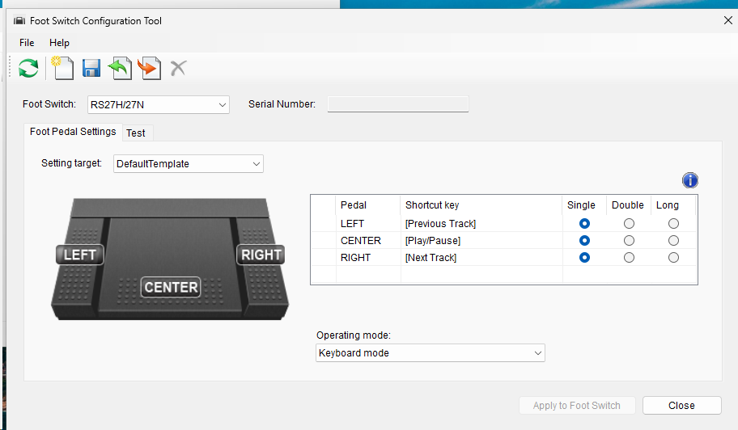

# Configuration protocol (reverse engineered 2026-11-14)

How OM Digital Solutions' **OM Foot Switch Configuration Tool 2.0.1** (Windows, `ftsw.exe`,
© 2024) talks to the RS-27H, and how `tools/omfs.py` does the same from Linux. Unofficial;
nothing here comes from vendor documentation.

## Method

- `ftsw.exe` is a .NET Framework 4 assembly. It was decompiled with `ilspycmd` 11.2
  (`dotnet tool install -g ilspycmd`, .NET SDK 10.0.115 on Ubuntu 26.04), which recovered
  readable C# with no obfuscation. The protocol lives in its classes `FootSwitch`
  (commands, items, record layouts) and `HIDController` (Win32 HID I/O). The decompiled
  source and the binary are **not** in this repo; only the facts needed to interoperate are.
- Every fact below was then checked against the real unit (serial redacted) from Linux on
  danieldesktop, over `/dev/hidraw7` (interface 0), with `tools/omfs.py`. Rows marked
  *inferred* come from the code only.
- A USB capture of the Windows tool also exists on the desktop
  (`~/olympus-capture/olympus-usb-2026-11-14.pcap`, captured from the libvirt host while the tool ran
  in the `win11` VM); it was not needed once the code was readable.
- No firmware update code exists in the tool. It only reads and writes settings, so there is
  no firmware image to extract.

## Transport

- USB HID, **interface 0** (Windows path contains `mi_00`). The tool opens every matching HID
  handle, sends a serial-number read to each, and keeps the first one that answers.
- Host → device: one **64-byte output report, report ID 0** (on Linux: `write()` 65 bytes,
  a leading `0x00` then the 64-byte command).
- Device → host: 64-byte input reports. A reply is recognised by byte `[8]` echoing the command.
- Timeout 500 ms per command; the tool retries the serial read 5× at 50 ms intervals.

## Command frame (64 bytes, host → device)

| Offset | Meaning |
| --- | --- |
| 0 | Command |
| 1 | Item ID (or mode, for `0xE2`) |
| 2–10 | Zero |
| 11… | Payload |

| Command | Name in the tool | Reply? |
| --- | --- | --- |
| `0xE0` | Read recorder item | yes |
| `0xE1` | Write recorder item | yes |
| `0xE2` | Recorder mode change (live) | **no** (the device re-enumerates) |
| `0xE3` | Restore default | yes |

## Reply frame (device → host)

| Offset | Meaning |
| --- | --- |
| 4 | Message: `1` accepted, `2` ignored, `0` none |
| 8 | Echoed command |
| 9 | Echoed item ID |
| 10… | Item data |

## Items

| ID | Meaning | Read reply data (from offset 10) | Verified |
| --- | --- | --- | --- |
| 0 | Model name | `08` then ASCII `RS-27H` | yes (not used by the tool) |
| 1 | Device status | `14 00 04 02` on this unit; meaning unknown | yes (named in the tool, never used) |
| 2 | Firmware version | ASCII `Ver 1.01` | yes (not used by the tool) |
| 6 | Serial number | length byte, then UTF-8 digits | yes |
| 23 | Pedal shortcut | see below; the read payload is `01 <pedal>` | yes |
| 24 | Default USB mode | one byte | yes |

Items 3–5, 7–22 and 25–255 all answer "ignored" (probed read-only, 2026-11-14).

### Item 23: pedal shortcut

Write payload (at offset 11), 12 bytes: `0B <pedal> <page> <trigger> <modifiers> 00 <k1> … <k6>`.
Read reply (at offset 10): `<pedal> <page> <trigger> <modifiers> 00 <k1> … <k6>`.

| Field | Values |
| --- | --- |
| pedal | `0` left, `1` right, `2` centre, `3` top (RS31 only). RS28 remaps 0→1, 1→2, 2→0 on write |
| page | `0x07` keyboard, `0x0C` consumer (media keys) |
| trigger | `1` single, `2` double, `0` long press. The UI shows them as Single, Double, Long |
| modifiers | HID modifier bitmap: `01` LCtrl, `02` LShift, `04` LAlt, `08` LGUI, `10` RCtrl, `20` RShift, `40` RAlt, `80` RGUI |
| k1–k6 | Keyboard page: up to 6 HID usages pressed together. Consumer page: one 16-bit usage, **little-endian** in k1–k2 |

**One record per pedal.** Reads with `02 <pedal>`, `00 <pedal>` or pedal `3` on the RS-27H are
ignored. So the firmware stores exactly three bindings, each firing on one trigger type.
Single/double/long chooses *when* that binding fires; it does not add more bindings.

Factory state read from this unit: left = Consumer `0x0B6` Previous Track, right = `0x0B5` Next
Track, centre = `0x0CD` Play/Pause, all single.

### Item 24 and command `0xE2`: USB mode

| Value | Tool label | Meaning |
| --- | --- | --- |
| `0x08` | "OM SYSTEM mode" | HID vendor reports only: the raw 4-byte button bitmap described in the README. Bindings are not applied |
| `0x18` | "Keyboard mode" | Vendor plus keyboard (`0x08 \| 0x10`): the pedal types its item-23 bindings |
| `0x10` | (debug) | Keyboard only; sent live via `0xE2` when the tool closes, never stored |

Item 24 is the stored power-on mode. **Resolved 2026-11-14:** writing item 24 with the value already stored (`01 08`) is answered
"ignored". Writing a different value (`01 18`) was accepted. So the device appears to refuse no-op writes (inferred from one
run each). Item-23
writes in the same session were accepted. Not yet known whether the device only accepts item 24
in keyboard mode, after a `0xE2` switch, or only when the value changes. Test that with `omfs.py usb-mode keyboard`
when keyboard mode is actually wanted. `0xE2 <mode>` switches immediately. When the tool exits it sends
`0xE2 08` or `0xE2 10` to match the stored mode, which explains its "reopening changes the mode"
warning. When it finds the **legacy product ID `0x0218`** (RS27/RS28 compatibility, what this
unit showed on 2026-08-13), it first sends `0xE2 0x18`; the device then re-enumerates as
**`0x0292`** (RS27H/27N), which is what it showed on 2026-11-14 (inferred from the code; the
re-enumeration itself was not watched).

Vendor and product IDs the tool knows: vendor `0x07B4` (Olympus) for H models, `0x33A2` (OM Digital
Solutions) for N models. Products: `0x0218` RS27/28 legacy, `0x025F` RS31 legacy, `0x0292` RS27H/N,
`0x0293` RS28H/N, `0x0294` RS31H/N.

## What this unlocks beyond the Windows tool

- **Keys the UI never offers.** The firmware takes any keyboard usage: `F13`–`F24` (`0x68`–`0x73`),
  up to 6 at once, with any modifier mix, e.g. `omfs.py set left f13`. And it takes any 16-bit consumer usage, e.g.
  `consumer:0xcf` (Voice Command).
- **Version and model readout** (items 0 and 2), which the tool never shows.
- **Backup/restore** of the on-device config as JSON.
- **More than three bindings needs the host, not the firmware.** In vendor mode (`0x08`) every
  pedal reports its own bit, and chords OR together (README, raw HID layer). A hidraw daemon can therefore implement
  single/double/long/hold per pedal, pedal combinations (L+C, L+R, C+R, all three) and layers,
  i.e. well over three bindings. That is the route for the context-dependent `Space`/`F13`
  plan in [linux-integration.md](linux-integration.md).

## Linux access

The hidraw nodes on danieldesktop are `root:plugdev 0660` and `daniel` is in `plugdev`, so no
udev rule was needed (2026-11-14). Interface 0 is the command channel; `omfs.py` picks it by
sysfs path (`…:1.0`).
